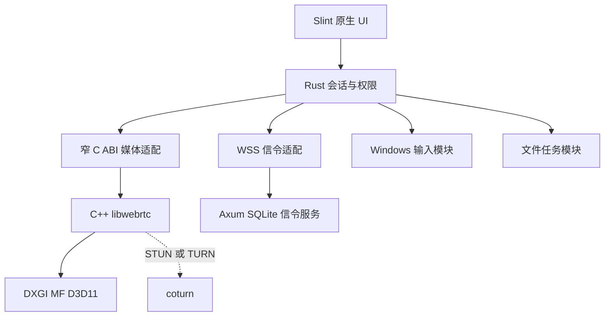
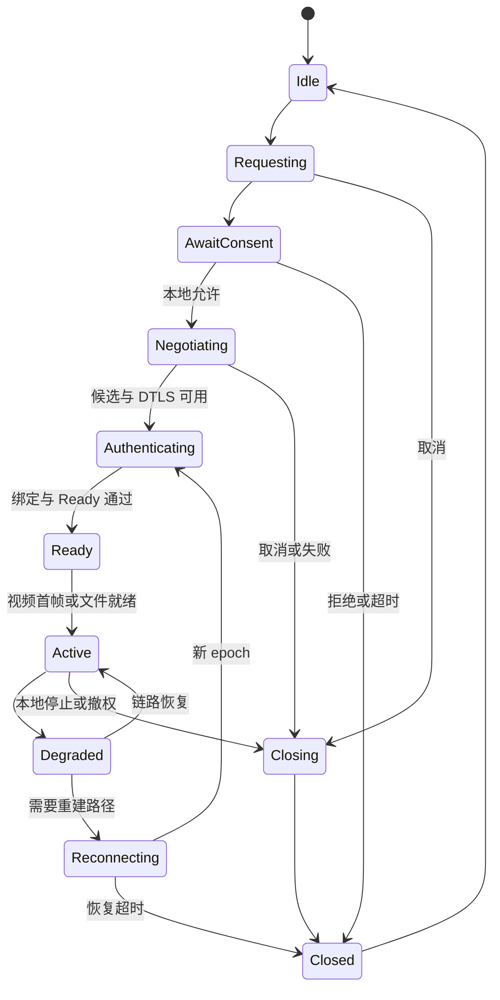
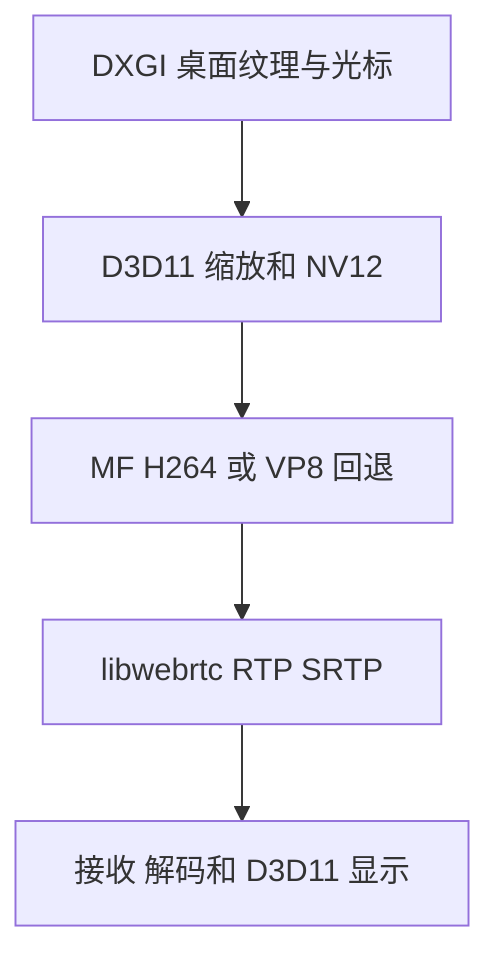

# EasyDesk 1.0.0 MVP PRD 与 Agent 开发规范

> 文档版本：1.0.0-draft.1  
> 整理日期：2026-10-26（Asia/Shanghai）  
> 目标产品版本：EasyDesk 1.0.0；**不是现有程序的已完成版本号**。  
> 当前工程状态：按随附材料为 **0.1.0 配对预览**；本次只合并材料与核对选定汇编文本，未取得产品源码、目标 PE、原始抓包或实际 Windows 测试环境，也未重新运行原材料的构建和测试。  
> 阅读对象：负责实现、审查、测试、部署及交接的 Agent 和开发者。本文可独立阅读，不依赖研究目录中的未提供附件。  
> 主线：沿用附件描述的 **Rust + Slint 原生 UI + C++ libwebrtc + Windows 原生媒体接口**；免账号协助、P2P 优先、可自建信令与中继、Windows 便携客户端。

## 0 Agent 执行规则

### 0.1 先读这些结论

1. 每份 EasyDesk 客户端同时包含控制与被控能力，普通用户双击同一个 EXE，不单独启动 Host 服务。**公网信令服务与客户端内置被控能力是不同角色**，不能用“内置服务端”推导“任意跨网无需服务器”。
2. 附件描述的现有原型已切换至 Rust/Slint；旧 PRD 的 C# WPF/QUIC 是历史方案。本次以现有工程为实施基线，不混合两套 UI 与两套媒体引擎。若产品方仍要求 C# WPF，必须先形成明确的 UI 迁移决策，不得把迁移伪装成已完成或在同一迭代悄悄重写。
3. MVP 主路径：WSS 设备定位与协商，ICE/STUN/TURN 建路，DTLS-SRTP 视频，SCTP DataChannel 控制与文件；视频不套应用层 KCP/QUIC，不自行复刻 UU 私有协议。
4. 免安装、无需用户部署服务器、媒体无需中继、完全零第三方依赖是四个不同承诺。本文默认自有或用户配置的基础设施；无服务器模式只覆盖具备可达路径并人工交换邀请的高级场景，不是 1.0 公网默认入口。
5. **已配对不等于已授权远控，信令在线不等于媒体已连接，本地文件浏览不等于远程文件传输。** 三种状态必须由不同的事实驱动。
6. UU 的静态导入、字符串、反汇编引用仅能支撑对应强度的结论；不能据此声称当前 UU 会话用了 KCP、QUIC、某个 FEC 参数或某条输入驱动。
7. 当前没有媒体、输入、远端文件、ICE/TURN 的实现通过记录。首要工作是安全会话与真实双机媒体，不是继续绘制假远控界面。
8. 完成声明必须给出源码 revision、构建命令、机器和网络条件、实测结果与证据位置。没有测试资源时标记 BLOCKED/NOT_RUN，不写“通过”。

### 0.2 实施前检查

- 先读目标仓库的 `AGENTS.md`、README、Cargo workspace、实际架构及路线图；本文件中给出的路径来自附件，必须到仓库核对后使用。
- 检查 `git status` 和既有分支，保留用户未提交内容。本文不授权提交、推送、部署、安装驱动或修改用户系统配置。
- 实现以本文的规范性需求与实际仓库约束为依据；遇到冲突，记录冲突和建议，不凭历史文档覆盖最新用户指示。
- 本文列出的签名消息和 C ABI 是待实现契约，进入编码前需要生成头文件、schema 和测试向量；不是可直接调用的 SDK。
- 所有配对码、私钥、TURN secret、恢复凭证均不得进入源码、普通日志、测试截图或公开报告。
- 不操作正在承载用户工作连接的 UU 会话。媒体验证、断网、键鼠、关机、驱动和弱网实验只在独立、明确授权的测试环境进行。

### 0.3 需求强度和事实标签

- **MUST**：1.0 发布阻断项；不能以不工作按钮、mock 或说明文字替代。
- **SHOULD**：默认采用的实现；偏离时写 ADR 和验证结果。
- **LATER**：不进入 1.0 发布门槛，不能抢占主链路实施顺序。

| 标签 | 意义 | 对 Agent 的约束 |
|---|---|---|
| REPORTED | 随附工程或验证文档报告的现状 | 本次没有源码复验；开工先核对 |
| STATIC | 随附库存/追踪及选定汇编支持的静态线索 | 不提升为运行事实 |
| OBSERVED | 原报告的某时刻只读进程/服务快照 | 不视为持续会话或包级证明 |
| STANDARD | RFC 或平台公开机制 | 不等同于 UU 的实际实现 |
| DESIGN | 本文为 EasyDesk 确定的产品、接口和参数 | 待实现与验收，不能标为已有 |
| UNKNOWN | 证据不足或材料未提供 | 保留未知，不补造结论 |

## 1 产品定义和版本边界

### 1.1 产品目标

EasyDesk 是 Windows x64 远程协助软件。两个用户打开客户端，通过设备 ID 与临时协助码发起申请，被控方确认权限后，完成桌面查看、鼠标键盘控制和文件传输。主窗口采用左导航、右内容的简单原生布局；独立远控窗口默认仅呈现桌面画面。

支持 Windows 11 x64 为基线，Windows 10 22H2 x64 作为独立兼容验证项；不因可启动就承诺所有老系统或媒体组件缺失的系统受支持。macOS 为后续平台，1.0 不宣称 Windows/macOS 互控已经完成。

### 1.2 MVP MUST 范围

| ID | 功能 | 用户可观察结果 |
|---|---|---|
| FR-01 | 双角色便携客户端 | 同一包可发起和接受协助，无强制安装系统服务 |
| FR-02 | 本机设备身份 | 重启后 ID 和公钥身份保持；可复制 ID、显示/换码 |
| FR-03 | 我的设备 | 本地已添加设备、备注、搜索、删除、可信身份与在线状态 |
| FR-04 | 免账号远程协助 | 输入 ID 和临时码，显式允许一次，能拒绝、取消和超时 |
| FR-05 | 安全会话 | 双端身份及 DTLS 指纹绑定，能力授权、重放拒绝、即时撤权 |
| FR-06 | 真实桌面视频 | 当前登录普通桌面；单屏传输、屏幕切换、缩放、全屏 |
| FR-07 | 键鼠输入 | 点击、拖动、滚轮、扫描码、中文文本及失联本地释放 |
| FR-08 | 连接与恢复 | P2P 优先、TURN 兜底、真实路径统计、ICE restart 和受限恢复 |
| FR-09 | 画质控制 | 办公/流畅/节流档；15/30/60 FPS 上限及实际参数反馈 |
| FR-10 | 文件传输 | 查找已添加设备；文件选择、接收确认、分块、校验、取消及安全续传 |
| FR-11 | 诊断 | 真实 FPS、码率、RTT、编解码器、直连/中继及降级原因 |
| FR-12 | 发布与数据 | 根目录可写数据、依赖完整、干净系统启动、手动升级保留数据 |

初版最多一个活动远控或独立文件会话；远控连接可附带一个文件任务队列。多人并发控制、多个媒体会话不属于发布要求。跨网支持以已完成的网络矩阵为准，不承诺 100% P2P 或所有封锁环境可连接。

### 1.3 明确排除

以下为 LATER：账号登录与同账号设备同步、无人值守、开机启动系统服务、登录前/锁屏/UAC 安全桌面控制、虚拟 HID/鼠标过滤/虚拟显示驱动、WoL、远程终端、端口映射、麦克风、系统声音、剪贴板同步、HDR、4:4:4、4K 高刷、游戏手柄、macOS、自动更新与管理员后台。

文件 MVP 支持普通单文件与多文件队列及单文件恢复；目录递归、整盘浏览、双向同步、文件差分和秒传为 LATER。研究材料中的声音、WoL、驱动及服务设计保留为扩展，不能因为 UU 含相关模块就纳入本版必做。

## 2 现有工程与目标方案的合并决策

### 2.1 当前状态清单

以下均为 **REPORTED**，来源为附件 `architecture.md`、`roadmap.md`、`validation.md`，不是本次执行结果。

| 能力 | 材料报告状态 | 不能据此宣称 |
|---|---|---|
| Rust workspace 和 Slint 页面 | Debug/Release 本机窗口可显示 | 远控窗口有真实视频 |
| Ed25519 与 DPAPI | 6 组本地存储检查通过 | 跨机密钥迁移无条件可用 |
| Axum/SQLite 信令 | 构建及 19 项真实 WebSocket 检查通过 | 公网双机 WSS 已验收 |
| 配对、在线订阅、取消/超时 | 服务端流程已验证 | 双 GUI 人工配对与保存全流程已通过 |
| 原生文件页面 | 有本机目录浏览 | 远端目录或文件传输已实现 |
| 便携打包 | Release ZIP 构建通过 | 最后修订的双栏和完整键盘遍历已复验 |
| 媒体、输入、声音、远端文件 | 尚未实现 | 已达到 1080p60 或低延迟 |
| ICE/STUN/TURN 与跨网 | 尚未实现 | P2P/中继已连接 |
| Windows 服务、驱动、WoL | 后续规划 | 当前拥有登录前或硬件唤醒能力 |

原记录指出两台电脑各连接默认回环服务时，可能都显示服务在线，却彼此找不到。**双方 MUST 使用同一个可达信令服务和一致的协议版本**；`127.0.0.1`/`localhost` 只用于同机开发。附件中从端口 9870 改为 39870 是一次本机绑定问题的处理，不是所有机器都应改防火墙或使用该端口的证明。

### 2.2 技术路线的唯一默认值

| 决策 | 本文主线 | 被取代或降级的材料建议 |
|---|---|---|
| UI | 沿用已描述的 Rust/Slint 原型，样式自写 | C# WPF 为历史目标；Tauri、egui、Qt 不同时引入 |
| 传输 | C++ libwebrtc：ICE、DTLS、SRTP、RTP/RTCP、SCTP | 旧 QUIC 自分片视频不再作为 1.0 主线 |
| 信令 | 自建/自有 WSS，Axum、Tokio、SQLite | 全网短 ID 且完全无外部服务不作为承诺 |
| 穿透 | 成熟 ICE 检查、STUN、TURN | 不实现猜端口、扫端口、自创多协议竞速 |
| 媒体 | DXGI/D3D11、MF H.264 硬编；VP8 软件回退 | 不一次接齐 FFmpeg、NVENC/AMF/QSV 专用 SDK |
| 输入 | 用户态 SendInput、状态机和本地看门狗 | 不以 UU 虚拟 HID 驱动作为初版前提 |
| 文件 | 可靠 DataChannel、16 KiB 起始分块、背压、SHA-256 | 不按内部 FTP 名称使用明文 FTP/21 端口 |
| 私钥 | DPAPI 当前用户保护 | 不为便携性明文保存私钥 |
| 账号/服务/音频/WoL | 放到扩展 | 不将研究报告的完整能力清单照搬成 MVP |

**UI 冲突处理：**旧版用户目标确实包含 Rust+C# 和 Windows 原生 UI，随附新工程记录则明确采用 Slint。本文沿用后者是为给现有工程提供连续开发路径，不意味着二者等价或曾经完成迁移。若开工仓库或用户最新要求仍是 WPF，Agent 应报告此决策冲突；媒体/session 协议可复用，UI 迁移单独评估，不同时维护两套产品入口。

### 2.3 尚无证据的工作

本次没有产品仓库源码、编译产物、完整 REA JSON bundle、原目标 PE、真实候选对统计或抓包。原材料引用的 `research/*.json`、脚本和 `ev_*` ID 只可登记为外部来源引用，不能声称本次已解析这些未上传文件。

本次可以复核的是选定反汇编文本中的数值指令和引用目标；无法仅靠反汇编文本重新验证原二进制 hash、完整导入表、ASLR 后地址或活动会话。后续 Agent 必须以实际仓库和新测试重建完成记录。

## 3 从 UU 调查中提炼的实现依据

### 3.1 样本和证据范围

研究对象为 Windows x64 UU 远程 4.43.1.3614 的选定安装文件。以下 hash 来自调查报告；当前未持有二进制，未重新对 PE 计算 hash。

| 样本 | 报告中的 SHA-256 | 用途 |
|---|---|---|
| 根启动器及 GameViewerLauncher | `a1d0ea2ec6703fd4fa6e46a5ed14c662efd4fec0538ea1ab5d37f4ae1143b2a8` | 区分启动器与主体 |
| bin/GameViewer.exe | `2047439c4ab8e91c026ade60b98348dc75c33e43f2f9ea0c3c68c5ce2c234d37` | UI 与业务线索 |
| bin/GameViewerServer.exe | `ecc3b0b0b5fefacb0f77c2f00d494647127887760d3eb8d94d07ee1b7dbdd2c6` | 被控、文件、输入与 WoL |
| bin/GameViewerService.exe | `fc6df85bc5fa9052656e1b0800784fd32500cbd6bc4bfa8868ae767a6db9b7e4` | 服务组件 |
| bin/streamer.dll | `7d66b438452af8c4c16e8ca41c0d7bfcbd4bf3344497e94747c7cad657d270e2` | 控制/被控接口与媒体网络线索 |

### 3.2 证据到设计的映射

| 证据 ID | 材料中的观察 | 允许结论 | EasyDesk 采用 |
|---|---|---|---|
| UU-01 | UI/Server 分别导入 ExchangeControllerInterface / ExchangeControlledInterface | 有控制/被控原生接口边界 | 明确 session 和窄 C ABI，不调用 UU DLL |
| UU-02 | streamer 导出 RVA `0x8e2640`、`0x8e26d0`，接口表拷贝 | 接口/回调表交换的高可信线索 | ABI 版本、长度、所有权和销毁约束 |
| UU-03 | STUN/TURN 源路径与代码引用 | 含相关实现分支 | ICE/STUN/TURN 标准栈 |
| UU-04 | mix-kcp/quic 扩展名被机器指令引用 | 扩展代码线索存在 | 作为研究，不据此重写首版传输 |
| UU-05 | NVENC/AMF/QSV/硬解/Opus/FEC 标记 | 多后端与恢复能力线索 | 能力探测、低延迟媒体和真实统计 |
| UU-06 | `sendNextBlock` 与响应虚调用 | 文件分块任务与发送抽象线索 | 权限、任务、分块、背压、恢复 |
| UU-07 | SendInput IAT 调用及 VHF/过滤驱动 INF | 至少有用户态输入路径和驱动组件 | 普通桌面先用 SendInput |
| UU-08 | Magic Packet 构造与 socket/广播/sendto | 有本地 UDP WoL 发送实现 | 后续通过受限 LAN helper 实现 |
| UU-09 | UI 含 Qt5 依赖及部分 WebView2Loader | 原生 Qt 和局部 Web 内容线索 | 不推导必须使用 Qt 或 Electron |
| UU-10 | 只读快照含 LocalSystem Session 0 服务和 Session 1 业务 | 至少有分进程/会话结构 | 安装版服务后续单独设计 |

来源关系：UU-01 至 UU-10 对应 `uuyc-artifact-inventory.md` 第 3 至 11 节、`uuyc-native-traces.md` 第 2 至 6 节及主调查第 2、3 节。证据 ID 是本文索引，不冒充 REA 生成 ID。

### 3.3 选定汇编可直接定位的入口

| 样本 | RVA/VA | 文本支持的事实 | 未解决 |
|---|---|---|---|
| streamer | RVA `0xf78e0`、`0x101cff` | RIP 引用目标为首选 VA `0x180ea6c50`，对应报告中 mix-kcp 字面量 | 是否创建了该传输 |
| streamer | RVA `0xf7968`、`0x101e57` | RIP 引用目标为 `0x180ea6c70`，对应 quic 字面量 | 完整协商/封装与当前选用 |
| Server | RVA `0x724a34` | 引用报告中块任务字符串 | chunk 大小与底层传输 |
| Server | RVA `0x5aee17` | 出现 `call *0x10(%rax)` | 虚调用类型和真实目标 |
| Server | VA `0x1405eaec4`、`0x1405eb066` | 调用同一 IAT 地址 `0x142021e50`；导入名称由原报告判为 SendInput | 当前输入后端 |
| Server | RVA `0xdf057f` 至 `0xdf0591` 等 | FF 初始化与 `0x10` 重复计数符合报告中的 Magic Packet 构造 | 从业务请求到实际代发的完整图 |
| Server | RVA `0xd8196e`、`0xd82c69`、`0xd82be0` | 间接调用目标分别对应报告里的 socket、setsockopt、sendto IAT | 目标设备 WoL 成功 |

必须区分 file offset、RVA、首选 VA 和 ASLR 后进程地址。`.pdata` unwind 范围可能是函数片段；不要将它直接命名为完整 C++ 函数，也不要从最近导出标签推导内部函数名。

### 3.4 明确保留的 UNKNOWN

- UU 当前会话 selected candidate pair、真实 P2P/中继及 KCP/QUIC/RTP 路线。
- UU 私有登录、会话、SDP 扩展、文件线缆协议和驱动 IOCTL 完整格式。
- 当前 codec、FEC 比例、GOP、重传时限和低延迟实测。
- 中继节点产权、经营主体、标准 TURN 与私有 relay 的对应关系。
- 当前使用 SendInput 还是驱动，以及 UAC/安全桌面/游戏的实际兼容性。
- WoL 的云端调度、LAN helper 选择和用户硬件/电源条件。

这些未知不阻碍独立实现 EasyDesk，但阻止宣称“已完整逆向并复刻 UU”。MVP 不需要调用 UU API、加载其 DLL、使用其服务、账号、私有驱动或官方节点。

## 4 页面与交互 PRD

### 4.1 导航与布局

主窗口采用左导航和右内容，顺序为“我的设备”“远程协助”“文件传输”，设置在底部。自行实现 Slint 样式，保留系统拖动、缩放、吸附、最小化、最大化和关闭行为。

建议尺寸 1000×700 DIP，最小 860×600 DIP；导航 216 DIP，内容留白 24 DIP，间距 8/12/16/24 DIP。主色蓝、浅色背景；不沿用 UU 商标和图片。控件必须有键盘焦点、可访问名称、禁用和错误状态；不能因软件渲染改变而出现不可见输入框。

不显示账号墙、广告、终端、端口映射和不可用“快速启动”入口。尚未实现的功能隐藏或明确标记，不使用户误认为点击后可以远控。

### 4.2 本机身份与协助页面

- 展示本机设备 ID、友好名称、网络配置状态、临时协助码和剩余有效期。
- 协助码默认掩码，可显示、复制和刷新；刷新后取消绑定旧码的待处理请求，不终止已经单独授权的活动 session。
- 显示“信令未连接/信令在线”；只有授权、传输和首帧条件满足才显示桌面会话已连接。
- 输入目标 ID 和码；解析到已添加设备时显示备注和已保存身份指纹。
- 当前 6 位配对预览码与本文 8 位目标协助码需通过协议迁移统一，禁止只改输入框长度而不改服务端验证、测试与说明。

### 4.3 我的设备

本地已添加设备不是同账号设备。支持备注、搜索、删除、最近连接和真实在线订阅；本机设备固定存在。远端状态只来自同一信令服务对指定 ID 的订阅，不请求全量在线设备列表。

保存完整公钥及其 SHA-256 指纹；设备 ID 只是可输入的定位索引。新公钥不能以相同短 ID 静默覆盖已有记录。设备被删除只移除本地记录，不撤销其他用户或修改对方客户端。

设备详情预览默认使用通用图，不在未授权时抓远端截图。历史截图若以后需要保存必须另立数据策略。离线/状态未知的设备仍可显示，但连接失败要说明原因。

### 4.4 发起与接受协助

1. 控制方指定目标 ID、当前码和所请求权限；在同一 WSS 命名空间定位。
2. 被控方本地核对临时码、有效期与请求状态；错误码不弹授权窗口。
3. 首次连接通过其他可信渠道核对完整公钥指纹。界面提供易读指纹，不能只看名称。
4. 弹窗展示请求方 ID、名称、指纹、请求“仅查看/允许键鼠/允许文件”的选项。默认只授予用户明确勾选的能力。
5. 允许一次后建立会话上下文，交换已签名 offer/answer 和候选。拒绝、取消、60 秒未处理或任一端离线则清理请求。
6. 只有双方身份、DTLS 和 SessionReady 成功后可打开媒体和数据权限。首帧和输入就绪分别更新，不用 PairResult.accepted 直接启动 SendInput。
7. 保存设备关系不保存临时码，也不授予未来无人值守。每次新 session 重新确认，除第 10 章限定的短时恢复。

### 4.5 远控窗口

MUST 默认只显示远端桌面，普通窗口允许系统细标题栏；不常驻工具栏、设备侧栏、文件区、聊天或统计面板。全屏无边框，等比缩放，黑边区域不发送输入。

本地保留 `Ctrl+Alt+Shift+F12` 打开会话菜单，提供：适应窗口、原始比例、全屏、屏幕切换、画质/FPS、统计、申请文件权限、断开。远端右键照常发送，Esc 照常给远端；本地快捷键不得注入对方。

进入无边框前检测可用退出入口；全局快捷键冲突时保留窗口关闭操作并提示。打开本地菜单或失焦先停输入并释放会话持有键；关闭菜单后重新取得焦点，不重放旧动作。

统计层默认关闭，用户开启后可显示紧凑诊断信息。原生 HWND 视频渲染与 Slint 层的混合需专项验证：不能假定普通 UI 控件可以自由覆盖 GPU 子窗口。可由 D3D 绘制诊断层，或使用独立本地弹出窗。

### 4.6 被控端与结束

主界面和托盘明确显示被协助状态、对端与权限，提供“立即停止”。紧急本地停止快捷键 `Ctrl+Alt+Shift+F11`；停止操作不得依赖服务器在线或远端确认。

关闭主程序默认停止会话并退出，不安装隐藏后台服务。仅用户选择“最小化到托盘”时继续工作；说明托盘状态。锁屏、注销、权限改变和安全桌面不可用按第 11 章处理。

### 4.7 文件传输页面

先查找已添加设备，再选择发送文件，独立文件 session 不采集桌面。可选择并复用已认证的远控连接，但必须取得文件能力和每批接收确认。

目标交互为本机文件选择/列表加远端接收任务与授权目录；现有双栏若两边都列本机目录，必须标注本地，不能显示为“远端”。1.0 不开放整盘浏览。接收方本地选择目录，发送方只拿 opaque root_id，不获任意路径访问。

队列最多 100 个普通文件，单任务一个文件传输；默认单文件最多 10 GiB，允许接收方调低。支持 Unicode 文件名、进度、速率、取消、重试和单文件恢复。目录拖入给出明确暂不支持提示。收到的文件不自动打开或执行。

## 5 网络角色与部署模型

### 5.1 默认产品模式

| 角色 | 处理内容 | 是否经过文件/画面 |
|---|---|---|
| 客户端内置被控模块 | 授权、采集、输入和接收文件 | 端点本身处理 |
| WSS 信令 | 公钥注册、在线订阅、请求、协商和 TURN 凭据 | 不承载文件与视频内容 |
| STUN | 映射与 ICE 检查辅助 | 不转发整段媒体 |
| TURN | 直连不可用时转发加密数据 | 是，但不终止端到端 DTLS |

同一台公网机器可运行信令和 coturn，部署角色仍分开。用户无需部署服务器可由产品提供服务；自建用户填写自有地址。两端 MUST 接同一可达服务。不预置未经授权的 UU 节点或所谓“永久免费”第三方 TURN。

### 5.2 无服务器模式的准确边界

| 模式 | 依赖 | 本文地位 |
|---|---|---|
| 同 LAN 发现与人工邀请 | 路由/防火墙可达、身份和协商交换 | 高级扩展，可优先做实验 |
| 公网可达 IPv4/IPv6 | 目标端口可达、地址已知、双端身份确认 | 高级扩展 |
| 人工 offer/answer | 双向交换 SDP、候选与签名 | 仅替代信令，不自动解决 NAT |
| 公共 STUN | 第三方映射服务 | 不是零服务器，不保成功率 |
| VPN/DHT/Nostr/消息平台 | 控制面、bootstrap 或 relay 等 | 不是无依赖，也非免费容量保证 |
| UPnP/NAT-PMP/PCP | 用户路由器能力及权限 | 不默认启用；CGNAT 外层仍可能阻断 |

短 ID 不携带完整端点；长邀请也不能创造可达路径。双方 CGNAT 不必然无法打洞，也不保证能靠 STUN 成功；无人值守本身不决定 NAT 是否可穿透，关键仍是在线、可达性、授权和中继条件。

**1.0 不实现“每层固定 3 秒依次降级”的自创链。** ICE 应并行收集检查并按成熟提名逻辑选择路径。端口预测、DHT、公共消息通道和 VPN 集成只留研究，不写成现有功能。

### 5.3 ICE 与路径展示

标准 ICE 候选包括 host、srflx、prflx、relay；prflx 可以来自检查中学习的本地或远端地址。controlling/controlled 是 ICE 角色，不等同业务控制端/被控端。

- Trickle candidate 绑定 session、发送方身份、epoch、ICE generation 和 ufrag；丢弃旧一轮候选，正确处理 end-of-candidates。
- 收集地址、成功建 DTLS、出现首帧是不同事件。
- 以实际 selected candidate pair 判定路径。任一选中候选是 relay 则标记中继；否则标记直连并显示实际 IPv4/IPv6。
- host↔host 不必然是同 LAN，也可能是公网 IPv6 或 VPN；未知时显示“直连，网络类型未知”。
- TURN/TCP 或 TURN/TLS 是接入中继的方式，不显示为“直接 TCP P2P”。

## 6 模块架构与工程结构

### 6.1 主结构



视频帧在 Windows/GPU 与 C++ 媒体链流转；Slint 和信令不逐帧收发 RGBA。Rust 负责可取消生命周期、身份、能力、输入与文件调度。媒体栈承担 ICE/DTLS/SRTP/SCTP 与实时拥塞控制。

### 6.2 路径责任

| 路径 | 已描述责任 | 实现时增加 |
|---|---|---|
| `crates/core/src/lib.rs` | Device、信令类型、签名注册、ID | 协议迁移、能力、规范签名上下文 |
| `crates/client/src/network.rs` | WSS 与命令/事件、重连 | 有界 session 信令路由，禁止像素处理 |
| `crates/client/src/main.rs` | Slint 状态、页面、目录 | 映射真实媒体、授权和首帧状态 |
| `crates/server/src/hub.rs` | 注册、在线、配对、限流 | session 路由、签名封装、短期 TURN 凭据 |
| `crates/session`（建议新增） | 无 | 唯一会话状态机、权限与取消 |
| `crates/media-ffi`（建议新增） | 无 | Rust safe 包装和 C ABI |
| `native/media`（建议新增） | 无 | libwebrtc、采集、codec、renderer |
| `crates/input-windows`（建议新增） | 无 | SendInput、映射、lease、看门狗 |
| `crates/transfer`（建议新增） | 无 | 文件授权、分块、校验、恢复 |
| `deploy`、`scripts`、`docs` | 部署与验证 | 固定构建、服务配置、验收记录 |

建议路径不是对已存在文件的断言；先核对实际 workspace，不为满足名称无意义拆 crate。

### 6.3 技术与版本冻结

- Rust MSVC x64、Tokio、Slint、Axum、SQLite 沿用仓库锁定依赖；不凭本文升级。附件 Rust 1.94.1 是原验证环境报告，不是本次可重现构建结论。
- libwebrtc MUST 固定源码 commit、DEPS、GN 参数、编译器/SDK、补丁集和完整依赖许可；禁止只写“最新版”。
- 从空缓存到 Release 产物提供 Windows 构建脚本；产物记录 SHA-256 和版本 manifest。缓存 DLL 不能代替可复现构建。
- H.264 硬编通过自定义 VideoEncoderFactory/DecoderFactory 接入 MF，并响应栈的目标码率、帧率和关键帧请求。编译一个默认 libwebrtc 不代表已经使用 MF 硬编。
- VP8 回退需同时探测双方能力，不能只切发送端 codec；不支持时清楚失败或降档。
- 不同时维护 str0m、libjuice、quinn、libdatachannel 和 libwebrtc 五套连接链路。替换引擎先写 ADR，再做能力和回归验证。

## 7 身份 配对与授权协议

### 7.1 标识与密钥

沿用现有 Ed25519 身份、DPAPI 当前用户保护和数据目录锁。保留当前 9 位设备 ID 作为索引；完整公钥和 SHA-256 指纹是安全身份，不把 9 位码当唯一密码学标识。

短 ID 冲突时返回 E_ID_COLLISION，禁止覆盖已注册公钥；不得每次失败就静默生成身份。扩展 ID 的映射和迁移另立版本变更。首次指纹通过可信外部渠道确认；服务端提供的名称和公钥不能替代这次确认。

跨电脑/用户复制 DPAPI 密文可能不可解密。保留旧文件并提示用户创建新身份，保留设备备注；新身份不能继承旧授权。损坏配置不静默重置身份；原子写、备份恢复和错误提示均需覆盖。

### 7.2 协助码和限流

DESIGN：1.0 统一使用安全随机 **8 位十进制协助码**，允许前导零，默认有效 10 分钟；每次启动、用户刷新、成功授权和申请终止后轮换。目标 wire protocol `easydesk-session/2`，不把代码实现中的现有 6 位 preview 协议直接当新媒体授权。

- 协助码只保留内存，严禁写 SQLite、settings、异常详情或普通日志。
- 每设备每分钟最多 5 次配对/session 发起尝试，重连不重置；每个请求方和接收方均限流。
- 每连接认证最多 3 次，连续 5 次失败启用 30 秒本机冷却；IP 限流仅作补充。
- 同实例一个待确认请求；授权弹窗 60 秒过期。
- 协助码只是低熵人工协助因子，不用于直接推导 DTLS/媒体加密密钥，也不形成永久控制口令。

现有服务会看到经 WSS 转发的协助码，属于受信任的元数据处理方。MVP 明确披露这一点；不以“WSS”声称信令服务器看不到码。长期目标可以改为经已绑定身份的端到端握手校验，但不得在未实施时改写信任模型。

### 7.3 权限

| capability | 允许 | 不包含 |
|---|---|---|
| `view_screen` | 指定显示器采集和接收视频 | 键鼠、文件、麦克风 |
| `send_input` | 普通桌面指定 session 的输入 | 高权限/UAC/系统安全注意序列 |
| `file_receive` | 接收方明确选择目录后的文件写入 | 任意绝对路径、整盘枚举、执行文件 |

`send_input` 必须伴随 `view_screen`；`file_receive` 可独立建立 file_only 会话。未来 read/list、clipboard、audio、wake 能力使用新版本/feature，不复用现有 mask 偷加权限。

文件权限按接收方向授予：A→B 必须由 B 授权接收并确认该批次，B→A 必须由 A 另行授权。会话记录和签名中使用 `subject_public_key + capability` 标识能力归属，不能用一个无方向的文件布尔值同时开放两端写入；双方角色反转不继承上一方向的接收目录。

被控方 MUST 本地同意 requested 的子集，签名绑定 granted 集合。UI 隐藏按钮不是安全控制；Rust 核心和文件/输入执行入口逐次检查 session、peer、epoch、permission_epoch 和 capability。

### 7.4 分阶段签名 避免循环依赖

不能只签一个 UUID，也不能让 Answer 签名依赖一个尚未生成的双方最终签名。采用以下独立设计：

1. **SessionRequest**：A 签名协议版本、request_id、session_id、双方完整公钥、角色、nonce_a、请求能力、expires_at。
2. **SessionAccept**：B 在本地允许后签名 request_digest、nonce_b、granted_caps、session_epoch、permission_epoch、expires_at。引用摘要是 SHA-256 原签名字节，不包含后来字段。
3. **Offer**：A 签名 accept_digest、ice_generation、nonce、原始 SDP UTF-8 字节摘要、SDP 内 DTLS fingerprint、消息序号。
4. **Answer**：B 验证 Offer，再签名 offer_digest、ice_generation、原始 answer 摘要和对端应验证的本方 DTLS fingerprint。
5. 双方将对端真实 DTLS 证书指纹与已验证 SDP 中的绑定值核对；经过认证的数据通道互发 **SessionReady**，内容含完整 transcript_digest、session/epoch 和 granted_caps。
6. transcript_digest 由 request/accept/offer/answer 的固定编码摘要按固定顺序计算，不包含 SessionReady，自身不循环。媒体/输入/文件在 Ready 条件完成前被应用层闸门阻止。

签名编码固定使用确定性 CBOR 数组布局：固定字段顺序、整数宽度语义、byte string、UTF-8 NFC 名称，协议域前缀 `EasyDesk-Session-v2`，对完整编码字节签名。JSON 是 WSS 可读外壳，不直接签不稳定 map 序列化。实际 schema、域分离和反例测试向量 MUST 在 T02 阶段冻结并审查；此处不是声称完整协议已经形式化证明安全。

每条 Offer/Answer 的确切字节快照签名后不再修改；后续 Trickle candidate 单独签名，不因 GetLocalDescription 动态加入候选而重算旧摘要。拒绝 SDP 中跨会话 fingerprint、非法算法、超大字符串、指纹缺失和未经许可的轨道/通道。

### 7.5 候选与更新认证

Candidate、EndOfCandidates、ICE restart 与配置更新都使用版本化的 SignedEnvelope，签名覆盖双方身份、session_id、session_epoch、ice_generation、seq、expires_at、message_type、payload_hash。候选携带 ufrag 和 mid/mline；只把验证通过且匹配当前 generation 的消息交给媒体引擎。

ICE restart 不必生成全新业务 session，但必须提升相关 epoch/generation，使用新的 ICE 参数与已验证描述；DTLS 身份变更重新绑定。旧消息不可被 WSS 重连队列补发进新会话。

## 8 状态机与功能就绪条件

### 8.1 状态分层

| 层 | 示例状态 | 完成事实 |
|---|---|---|
| 信令 | Offline、Connecting、Registered | 同一 WSS 服务已认证注册 |
| 配对 | Idle、Pending、Accepted、Expired | 保存且核对设备身份，仅是关系 |
| 授权 | Requested、AwaitConsent、Authorized、Revoked | 被控本地同意当前权限 |
| 传输 | Gathering、Checking、DTLSConnected、Ready | 当前候选可用、身份绑定、数据握手通过 |
| 视频 | NotStarted、WaitingFrame、Streaming、Frozen | 真实新帧已呈现 |
| 输入 | Disabled、LeasePending、Enabled | 授权有效、输入通道与 lease 就绪 |
| 文件 | Offered、Accepted、Sending、Verifying、Committed | 接收侧最终结果确认 |

UI MUST 组合这些事实，禁止用单个 `connected: bool` 覆盖全部状态。文件-only 会话不能显示桌面 Streaming。

### 8.2 主会话状态



图仅列主路径；任意未关闭状态都可以取消，Authenticating 失败也必须 Closing→Closed。所有关闭统一幂等，晚到 Accept/Answer/Candidate 不能复活 session。

### 8.3 就绪谓词

```text
transport_ready = identity_pinned && dtls_binding_valid && data_handshake_valid
screen_ready = authorized(view_screen) && transport_ready && first_frame_presented
input_ready = authorized(send_input) && transport_ready && input_channel_open
              && valid_input_lease && display_generation_current
file_ready = authorized(file_receive) && transport_ready && receive_batch_accepted
```

即使 ICE 成功或验证码正确，上述条件不满足也不能注入或传文件。

## 9 信令后端接口与资源限制

### 9.1 原有约束与目标上限

保留原预览的挑战注册、完整身份核验、指定 ID 在线订阅、取消和过期；不提供全量在线设备枚举。以下为起始上限，基于附件现有值扩展，后续须压测：

| 项目 | 初值 | 处理 |
|---|---|---|
| 每实例 WSS 连接 | 128 | 超出返回可解释忙碌 |
| 未注册超时 | 5 秒 | 关闭未认证 socket |
| 文本消息 | 64 KiB | 分配前/读入时限制，连接级拒绝 |
| 每连接速率 | 20 条/秒，允许小突发 | 合并候选；不可用过载绕过 |
| 每连接普通队列 | 32 条 | 背压，不无限缓存 |
| 身份在线订阅 | 每客户端最多 100 ID | 只返回其订阅范围 |
| 每设备配对/session 请求 | 5 次/分钟 | 跨 socket 保留计数 |
| 待处理申请 | 每设备 1 个 | 60 秒过期 |
| 写阻塞 | 5 秒 | 关闭或重连，不阻塞整个 hub |

SDP 或 Candidate 不得因超限而无界放宽所有消息。Offer/Answer 超 64 KiB 时先裁剪禁用功能和候选快照；仍超限返回 E_MESSAGE_TOO_LARGE。候选批量最多 8 条/批，签名包含完整数组，序列与流控约束不得丢失。未认证请求不能消耗昂贵媒体资源。

### 9.2 WSS 消息契约

```json
{
  "protocol": "easydesk-session/2",
  "type": "session.offer",
  "request_id": "<128-bit-random-id>",
  "session_id": "<128-bit-random-id>",
  "session_epoch": 1,
  "ice_generation": 0,
  "seq": 4,
  "from_device_id": "<locator-id>",
  "to_device_id": "<locator-id>",
  "signed_payload": "<base64url-deterministic-cbor>",
  "signature": "<base64url-ed25519-signature>"
}
```

以签名字节内的身份和字段为准；JSON 外壳重复值必须完全一致，否则拒绝。示例全是占位符，不可当作有效样例。媒体、文件字节不经 WSS/JSON/Base64。

| 消息族 | 责任 | 处理主体 |
|---|---|---|
| register.challenge / register.response | 一次性 nonce 与设备签名注册 | server/core |
| presence.subscribe / presence.update | 指定 ID 在线状态 | server/client |
| pair.request / pair.result | preview 兼容期间的设备关系建立 | 旧客户端；不授媒体权限 |
| session.request / accept / reject / cancel | 当前会话权限和人工确认 | session |
| session.offer / answer | 不变 SDP 及身份绑定 | session/media |
| session.candidates / gathering_complete | 增量候选、generation | media 适配 |
| session.end / revoke | 幂等关闭或权限降低 | session |
| turn.credentials | 授权会话的短期配置 | server，客户端仅获临时值 |

注册协议是否可保持旧版由实际源码决定；session/2 与 preview 的 feature 位必须显式协商。旧客户端只能使用已实现 preview，不能在协商失败时降级成不认证的桌面控制。

### 9.3 服务端信任与数据

服务端保存设备 ID、完整公钥、名称、平台、最后登记与 schema 版本。在线表、协助码转发、待确认请求、短期 session 路由放内存；重启后失效，不恢复旧授权。日志不存码、SDP 凭据、TURN password 或用户文件名。

WSS TLS 验证证书和主机名；只有显式开发模式允许回环 WS，禁止生产 `accept_invalid_certs`。注册签名证明身份私钥持有，不防所有恶意转发；独立签名的会话描述和外部指纹核对用于防止被替换的媒体端点。

## 10 连接恢复与停止规则

### 10.1 时限起点

DESIGN：初始会话协商 20 秒无进展提示失败，整体 30 秒超时；媒体缺新帧 2 秒进入 Frozen，停止接受基于旧画面的点击，并停止续约输入 lease，使被控本地看门狗释放输入。静态桌面必须仍有可验证的存活/新鲜度信号，不能仅因没有像素变化误判冻结。DataChannel 会话心跳 1 秒一次；传输 disconnected、输入 lease 过期或本地撤权立即禁用输入。

短时恢复窗口最多 15 秒，从首次确认失联计；sleep/lock、用户停止、身份改变、session 已撤销均不可自动恢复。完成新 generation、身份绑定、SessionReady 和显示布局同步后才恢复输入；不得回放断网期间动作。

时限是可测试的默认值，不是 WebRTC RFC 固定值。极高 RTT 场景应让 UI 解释 lease 失效与质量降级，不能为不断线无限延长危险按键状态。

### 10.2 信令断开和媒体断开分开

已认证且授权仍有效的 P2P 媒体不因 WSS 短时断线自动关闭。不能经断开的 WSS 新申请权限、发起 ICE restart 或取得 TURN 续期；本地停止仍立即生效。初版授权最长连续 8 小时，双方单调计时到期结束，不能依赖信令服务器断线来撤权。

WSS 重连指数退避 1/2/4/8 秒，最大 30 秒并带随机抖动，恢复后重新挑战注册和订阅。旧待确认请求不恢复，活动 session 的状态不可被重新注册的 presence 覆盖。需要中继凭据或重协商而 WSS 不可用时明确失败。

### 10.3 本地关闭顺序

1. 原子将 session 标记 Closing，拒绝新输入、文件和协商命令。
2. 被控本地立即撤权、释放会话注入键，取消文件读写和采集。
3. 尽力通过数据/WSS 发 End，但不等待它成功才停止。
4. 停止回调注册，drain 在途事件，关闭 PeerConnection 和媒体线程任务。
5. 脱离渲染 HWND，等待 GPU/回调安全点，释放资源；返回 UI Closed。

停止、超时和销毁均幂等。销毁后任何回调访问 UI/user_data 都是缺陷。

## 11 媒体链与性能策略

### 11.1 第一条可验收链路



控制端和被控端角色反转不改变发行包，按需初始化对应采集/解码模块。无媒体会话时不初始化 GPU 采集和 codec，不持续遍历大目录。

MUST 探测而非猜测：采集是否可用、硬编/硬解、profile/level、输入纹理格式、分辨率/FPS、显卡间共享和颜色范围。统计记录实际 encoder/decoder、hardware 标记和回退原因。

### 11.2 采集和 GPU 资源

- 正确配对 AcquireNextFrame/ReleaseFrame，处理旋转、dirty/move rect、光标和超时。
- 显示器拔插、AccessLost、DeviceRemoved、分辨率改变时重建；新 display_generation 使旧输入失效。
- 采集至编码队列最多 2 帧，保留最新未编码帧；呈现侧同样有界。不能任意丢弃已编码参考帧而不处理依赖。
- 优先 GPU 纹理路径，但跨 GPU、软件回退或 codec 不支持可能需要回读；记录实际复制，不宣传未测量的零拷贝。
- SDR、8 bit、通常 4:2:0 为首版。高 DPI、彩色细线和文字可读性单独验收，不以“1080p”代替画质。

### 11.3 编解码与 WebRTC 集成

编码器必须正确实现 init、rates、encode、keyframe、flush/release 和失败回退；将 libwebrtc 带宽估计与实际 MF 码率控制连接。解码器输出格式和 GPU 设备所有权明确，渲染队列不阻塞网络回调。

请求低延迟模式并检查返回值，避免无必要帧重排；实际 MFT 支持以返回能力为准。关键帧请求限频建议 500 ms，不盲目提高 FEC 或连续发大 IDR。NACK/RTX、pacer、RTCP 与抖动缓冲优先由栈管理，勿外套 KCP 导致双重可靠队列。

VP8 回退先保证 720p30 及可解释资源开销；H.264 高档失败重新协商，不给用户显示硬编已开启的假状态。H.265、AV1、NVENC/AMF/QSV 专用 SDK 不作为 1.0 必须项。

### 11.4 用户设置与实际值

| 档位 | 起始请求 | 网络不足时 |
|---|---|---|
| 自动办公 | 1080p30，目标 3–6 Mbps | 先减 FPS，再视可读性降分辨率 |
| 动态流畅 | 合格硬件 1080p60，目标 6–12 Mbps | 优先控制延迟，必要时降低分辨率 |
| 节流 | 720p15–30，目标 1–3 Mbps | 进一步降档或明确不可用 |
| 自定义 | FPS 上限 15/30/60；码率上限 1–30 Mbps | 不突破双方协商能力 |

码率均是实验起点，不是最低带宽或无损质量保证。源分辨率超过 1080p 的请求为实验档；1.0 不承诺 4K60。静态桌面允许低刷新但保持光标/控制通畅；动态 FPS 验收必须使用固定动态样本。

### 11.5 统计定义

| 指标 | 含义 | 禁止误用 |
|---|---|---|
| capture/encode/render FPS | 不同阶段实际帧率 | 不能显示用户设定值冒充实际值 |
| video bitrate | 实际视频负载或带宽，标明口径 | 不与整个网卡流量混用 |
| RTT | 指定候选/传输的往返时间 | 不标成输入到画面总延迟 |
| encode/decode ms | 同端处理阶段耗时 | 不与跨端墙钟直接相减 |
| selected candidate pair | 当前真正选中路径 | 配置优先 P2P 不代表当前 P2P |
| buffered/queued age | 应用和栈排队情况 | 不能只报带宽忽略积压 |
| freeze/loss/RTX/PLI | 真实恢复与质量情况 | 未暴露指标填 null，不填 0 |

UI 每秒刷新统计；更高频采样仅在核心聚合。诊断导出先脱敏候选 IP、设备标识、文件名和凭据，禁止默认上传。

## 12 键鼠协议与失联安全

### 12.1 通道分工

| 通道 | 设置 | 作用 |
|---|---|---|
| `control.v1` | 可靠、有序 | Ready、权限、心跳和结束 |
| `input.v1` | 可靠、有序 | Key/Button/Wheel/TextCommit/状态同步 |
| `pointer.v1` | unordered、maxRetransmits=0 | 最新移动点与光标反馈 |
| `files.meta.v1` | 可靠、有序 | Offer/Accept/Cancel/Commit/Resume |
| `files.data.v1` | 可靠、有序，小块 | 文件内容 |

各逻辑流共享底层资源与拥塞预算。拆通道不自动保证鼠标优先；必须有应用背压、预算和并发验收。是否支持消息交织由锁定的 libwebrtc 构建验证。

### 12.2 输入消息

```protobuf
// 本文的独立设计，不是 UU wire format；字段号需 T02 冻结。
message InputEnvelope {
  uint32 protocol_version = 1;
  bytes session_id = 2;              // 固定 16 字节
  uint64 session_epoch = 3;
  uint64 permission_epoch = 4;
  uint64 seq = 5;
  uint64 display_generation = 6;
  bytes input_lease_id = 7;          // 固定 16 字节，当前连接绑定
  oneof event {
    PointerMove pointer = 10;
    KeyEvent key = 11;
    ButtonEvent button = 12;
    TextCommit text = 13;
    InputState state = 14;
    ReleaseAll release = 15;
    WheelEvent wheel = 16;
  }
}
```

示意中引用的消息需补成真实 `.proto` 才能编译。事件限定长度、数组数量、Unicode 码点和数值范围。WheelEvent 至少含水平/垂直方向、增量单位、事件位置与 display_generation；高精度滚轮保留累计余量，不将每个小增量截断为零。

PointerMove 带归一化坐标或明确相对 delta，不能混算。Button 带事件发生位置与 display_generation，以防丢移动包造成点错位置。两通道分别有序号，状态同步引用可靠输入流的 last_applied_seq，不用未同步的两端墙钟决定关键顺序。

### 12.3 坐标与输入模式

实际视频矩形排除黑边和本地菜单，控制端 DIP 转物理像素后做归一化；被控端映射到对应显示器物理矩形与整个虚拟桌面。支持负坐标、旋转、多屏与混合 DPI；边界像素按尺寸减一处理。

键盘默认物理扫描码，保留左右修饰键、extended、down/up、repeat；文本模式发送本地 IME 完成后的 Unicode/TextCommit，两模式避免重复输入。AltGr、非 US 布局、非 BMP 字符必须测试。

控制端本地保留退出快捷键，不截走用户远端应用正常 Esc/右键。主控窗口失焦、切屏或打开菜单时发送最佳努力 ReleaseAll；远端物理输入与本会话注入输入区分，防输入回环与误释放。

### 12.4 本地看门狗 MUST

仅靠“断线时控制端发送 key-up”是不成立的，真正断线时包可能永远送不到。被控端输入模块独立维护注入集合和 lease，看门狗不得运行在可能被网络/磁盘任务阻塞的队列里。

DESIGN 初值：控制端每 100 ms 通过可靠输入流发送 lease renewal，最大突发 1；被控端 lease 默认 750 ms 无有效续约即到期。在高 RTT 下可协商最长 1500 ms，超出则禁止输入而不是无限持键。

续约携带被控发出的单次 challenge/lease generation；challenge 的有效期由被控本地单调时钟判断，验证后消费，旧序号和已失效 lease 不能延长。过期先释放键/按钮并终止旧 lease；即使迟到的 renewal 到达，也必须重新执行带新 challenge 的重新使能握手，不把排队旧数据当新授权。重新使能后清空状态、拒绝过期动作。

必须触发本地释放的条件：transport 断开、lease 到期、权限撤销、SessionReady 失效、本地停止、显示布局重建、锁屏/会话切换和进程正常退出。只释放该 session 注入且当前仍由它持有的状态；不要无条件清空用户物理键盘。

### 12.5 Windows 权限边界

SendInput 受 UIPI、桌面和交互用户限制；普通用户不能保证控制管理员窗口。某些失败不能从 GetLastError 唯一区分 UIPI，UI 不凭错误码过度诊断。锁屏、UAC 安全桌面和登录前不属于首版支持，遇到时停止危险输入并明确提示或关闭会话。

不以自动提权、关闭 UAC、安装未签名驱动或向 Session 0 注入来解决。后续服务应与用户会话代理经 ACL IPC 通信，而非把整个 UI 和输入塞进 LocalSystem 服务。

## 13 文件传输协议

### 13.1 会话与权限

文件模式使用已添加且核对身份的设备；每批被接收方确认，file_only 也有独立 session、Ready 和 capability。发送方仅提交文件名、大小、摘要/源版本，接收方本地选目录并返回 opaque root_id，不暴露完整磁盘路径。

相同设备关系不等于 file_receive 永久有效。远控允许只查看时，不能因存在文件按钮而获得读写。1.0 不支持远端任意目录 ListRequest；该能力留独立 file_list/file_read 扩展。

### 13.2 消息和状态

| 消息 | 字段 | 接收端要验证 |
|---|---|---|
| TransferOffer | transfer_id、manifest_version、文件数组、总大小、manifest_digest | 身份、权限、文件数、大小、名称 |
| TransferAccept | transfer_id、root_id、冲突策略、window_bytes | 当前批次确认和接收目录 |
| FileBegin | file_id、source_generation、size、chunk_size | 已批准文件与合法大小 |
| Chunk | file_id、generation、offset_u64、bytes、chunk_sha256 | 偏移、长度、范围、源版本和哈希 |
| ChunkAck | file_id、verified_ranges、durable_offset | 不把已发送当已落盘 |
| ResumeRequest | manifest_digest、file_id、generation、known_ranges | 新授权会话及源版本一致 |
| ResumeReply | accepted_ranges、restart_reason | 只使用已验证的接收范围 |
| Cancel | transfer_id/file_id、reason | 幂等停止与清理 |
| Commit | expected_size、whole_sha256、generation | 完整长度和文件摘要 |
| CommitResult | success、durable_level、final_name、error | 仅这一步显示成功 |

任务状态：Offered→AwaitAccept→Sending→Verifying→Committing→Completed；可转 Cancelled、Interrupted 或 Failed。重启或断网从 Interrupted 经新会话重新授权后 Resume；不能自动恢复已撤销 session。

### 13.3 分块与调度

- 16 KiB chunk 是首轮起点；完整消息头加 payload 必须小于双方协商的 DataChannel message size。
- 初始应用在途窗口 512 KiB，单文件数据排队硬上限 2 MiB；根据 RTT/磁盘实测调整，但始终有明确上限。
- 监听 buffered amount 和低水位，队列高水位时暂停读盘，不把数 GiB 文件读入内存。
- 实时远控中默认占已估计剩余预算，输入 RTT/媒体队列恶化则暂停文件数据；控制、取消和元数据仍可发。
- SCTP 多 stream 不等于独立带宽。大消息会影响实时流，必须用文件并发测试确认。
- 每 250 ms 至 1 秒聚合进度，区分 source_read、sent、received、verified、committed。100% 已发送不能显示“对方保存成功”。

### 13.4 完整性和续传

发送端为源文件生成 generation，读取时记录文件身份、大小与修改信息；以摘要确认内容，mtime+size 只作快速筛选。修改中的源应拒绝续传并重启该文件，不能拼接成不同版本。

接收端在目标同卷写 `.part`，维护 schema_version、manifest_digest、已校验区间与临时文件身份。元数据与文件需要一致更新；写入 OS cache 不等于断电持久化，Ack/Commit 明确 durable_level。崩溃后重新核对区间哈希，宁可回退已确认位置，不把未验证区域当成功。

最终检查 size 和 SHA-256，再按冲突策略安全 rename。默认生成新名称不覆盖；允许覆盖必须另行确认且不能先删除原文件。临时文件丢失、源变化、元数据损坏或权限不同返回具体 restart_reason。

### 13.5 Windows 路径边界

拒绝 `..`、绝对/UNC/设备路径、盘符、NTFS ADS、保留设备名、非法字符及尾随点空格，校验 Unicode 和路径长度；限制条目数与声明大小，检查 offset+length 溢出。

仅做字符串 startsWith 不足以防 junction/symlink/reparse point 和 TOCTOU。使用受控目录/文件句柄、不跟随策略和最终路径复核，确保创建、写入、最终 rename 全部仍在授权目录内。临时文件随机命名并安全创建，不能让远端选择系统路径。

磁盘满、权限撤销、设备拔出、文件占用、同名竞争和进程退出均必须清理或标记 Interrupted。取消不删除用户既有文件；未完成部分经确认可留待恢复，默认启动时清理超过 24 小时且不再使用的临时任务。文件内容与真实路径不进入普通日志。

## 14 窄 C ABI 与线程生命周期

### 14.1 设计边界

Rust/Slint 不跨 FFI 传 Vec、String、C++ STL、异常或每帧 RGBA。传 opaque handle、带 size 的 POD、显式 UTF-8 字节长度与事件；ABI version 不兼容时拒绝加载。

建议边界如下，**为接口草案，不是已实现头文件**：

```c
uint32_t ed_abi_version(void);
int32_t ed_engine_create(const EdEngineConfig* config, EdEngine** out);
int32_t ed_session_create(EdEngine*, const EdSessionConfig*, EdSession** out);
int32_t ed_session_set_remote_description(EdSession*, const uint8_t*, size_t);
int32_t ed_session_add_ice(EdSession*, uint32_t generation,
                          const uint8_t* candidate, size_t len);
int32_t ed_session_set_render_target(EdSession*, void* hwnd);
int32_t ed_session_send_data(EdSession*, uint32_t channel,
                            const uint8_t* bytes, size_t len);
int32_t ed_session_set_permissions(EdSession*, uint64_t epoch, uint64_t mask);
int32_t ed_session_poll_event(EdSession*, uint8_t* out,
                             size_t capacity, size_t* needed, uint32_t timeout_ms);
int32_t ed_session_close(EdSession*, uint32_t reason);
void ed_session_destroy(EdSession*);
void ed_engine_destroy(EdEngine*);
```

真实实现还要补出 EdEngineConfig、EdSessionConfig、完整错误码、create_offer/create_answer、本地描述事件、capture/screen 切换、stats 和 renderer detach；未补完之前不能宣称 ABI 已冻结或媒体桥已交付。

### 14.2 所有权和退出

- 配置结构首字段 `struct_size` 与 `abi_version`；句柄只能由对应销毁函数释放。
- 输入 bytes 在调用返回前复制或约定调用期间借用；不得把临时 Rust 指针存入异步任务。
- poll 使用调用方分配 buffer；BUFFER_TOO_SMALL 返回 needed，事件保留供重试；单事件最多 256 KiB。
- Close 拒绝新任务；Destroy 在 Close 后等待网络/worker/signaling/渲染线程排空，停止所有回调。Rust 包装器先取消并等待自身 poll 任务，再销毁句柄。
- HWND 在 renderer detach 确认前保持有效；GPU texture 引用和 fence 明确。网络回调不等待 UI，UI 线程不做网络与 codec 工作。
- C++ 捕获异常返回错误；Rust panic 不越过 FFI。测试 double-close、取消中销毁、回调晚到、窗口先关闭、GPU reset。

### 14.3 队列预算

| 队列 | 起始上限 | 溢出策略 |
|---|---|---|
| 普通 UI 命令 | 32 | 返回 Busy/取消旧可替代配置 |
| session 关键控制 | 64 加独立紧急关闭状态 | 不丢撤权；饱和即 fail closed |
| stats | 1 个最新快照 | 替换旧值 |
| pointer | 1 个最新位置 | 丢弃旧移动 |
| 待编码/待呈现帧 | 各 2 | 丢弃过时未消费帧 |
| 文件数据 | 单文件 2 MiB | 暂停读盘/背压 |
| 全 session 重组/协议解析 | 独立显式字节预算 | 超限错误，禁止按声明无限分配 |

关键撤权与停止通过原子状态直接影响执行闸门，不依赖进入一个已塞满的视频/文件 FIFO。

## 15 本地数据与版本迁移

### 15.1 便携目录

| 路径 | 内容 |
|---|---|
| `EasyDesk.exe` 与原生媒体库 | UI、Rust 核心和随包运行依赖 |
| `resources/`、`LICENSES/` | 自有图标、默认样式、许可和版本 manifest |
| `data/settings.json` | schema_version、revision、信令 URL、画质与路径设置 |
| `data/identity/` | DPAPI 密文私钥及公开证书/公钥 |
| `data/easydesk.db` | 本地设备、历史、文件任务与迁移记录 |
| `data/logs/` | 脱敏轮转日志，建议 5×10 MiB |
| `data/temp/` | 应用管理临时内容 |
| `downloads/` | 默认接收目录 |

实际现有配置文件名先核对再迁移，不能直接删旧文件换成本文路径。程序根目录来自 EXE 实际位置，不来自启动 working directory；只读时明确停止初始化，不偷偷写 AppData。外部接收目录只能由用户主动选择。

无额外安装不等于零依赖；媒体组件、显卡驱动、CRT、DLL 和原生渲染后端都需验证。不要打成默认解包到系统 TEMP 的单 EXE 却宣称所有运行资源始终在根目录。

Windows 系统日志、防火墙、杀毒缓存和系统崩溃记录不由应用控制，不能承诺系统零痕迹。

### 15.2 数据表与迁移

客户端建议表：devices、device_endpoints、sessions、transfers、transfer_files、resume_ranges、schema_migrations。服务端只保留公共设备元数据，不把客户端文件元数据同步到信令数据库。

- device 主身份以 full fingerprint 唯一，locator_id 单独索引；相同短 ID 不合并不同公钥。
- session 记录开始/结束、mode、direction、结果和 transport，不存验证码与恢复凭证。
- transfer 的 source generation、manifest digest、目标 opaque root 映射、校验区间区分内存与持久化状态。
- 迁移在事务中执行，备份可恢复；损坏数据不静默重新生成身份。
- 当前数据目录锁继续有效，SQLite WAL/SHM 与主库同目录。运行中备份用 backup API，不只复制主 db。
- 0.1 preview 升级到 1.0 时保留已配对公钥与备注，但清除旧待确认请求和所有临时授权；新增 schema 和 protocol feature，不靠修改版本字符串完成升级。

## 16 STUN TURN 与信令部署

### 16.1 端口与配置

| 接口 | 建议入口 | 限制 |
|---|---|---|
| WSS | TCP 443，经 Caddy 等反代 | 正确证书、WebSocket 升级、后端仅回环/私网 |
| 开发信令 | 回环 TCP 39870 或显式配置 | 该数字来自附件实测，不保证所有机器可用 |
| STUN/TURN | UDP/TCP 3478 | 需入口与实际 relay 端口同时放行 |
| TURN/TLS | TCP 5349，受限网络可用独立 IP:443 | 不是 HTTP，普通路径反代不足 |
| relay allocation | 实验 UDP 49160–49259 | 示例范围，需测容量并与安全组一致 |

WSS 与 TURN/TLS 不能简单同时绑定同一个 IP:443。需要第二 IP/节点或实际验证的 L4 分流。服务器位于 NAT 后必须正确配置 advertised external/relay 地址和端口映射；只开放 3478 不能证明中继可用。

### 16.2 凭据和资源

服务端在 session 授权后签发短期 TURN credential，客户端只得到 username/password/urls，不获得 shared_secret。coturn REST 具体格式按锁定版本官方文档实现，不把普通账号密码或 UUID 当长期共享 secret。

初始 TTL 10 分钟可作为测试参数；必须在有效期内验证 allocation refresh、凭据更新和长会话续期。更新 IceServers 是否影响现有 allocation 取决于引擎，不能假设改配置就无缝；必要时经签名协商进行 ICE restart，保持原权限边界。

MUST 拒绝匿名 allocation、过期凭据、超配额和不允许的 peer 地址；限制总连接、带宽及滥用，避免开放代理。禁止 relay 到回环、链路本地、云元数据及部署策略不允许的内网。凭据和服务器主密钥不记录普通日志。

### 16.3 费用与容量口径

8 Mbps 的单向净视频约每小时 3.6 GB；一个节点转发时通常接收一次、发出一次，NIC 收发合计约 7.2 GB，实际费用取决于供应商出口口径，另加协议/RTX/FEC/文件。这个算术不是 UU 实测或固定画质带宽。

容量按中继并发、真实码率、包率、allocation、CPU、出口和中继占比估算，不能只比较信令进程内存。发布必须有直连和强制 relay 两类实测；TURN 进程运行或 TCP443 握手成功不算中继验收。

## 17 性能与稳定性目标

以下均为 DESIGN，未达成；与 UU 比较必须使用相同机器、网络、分辨率、负载和清晰度。

| 指标 | 发布验收目标 | 说明 |
|---|---|---|
| 真实视频 | 合格硬件 1080p60 动态样本平均 render FPS≥55 | 静态桌面自然低帧率单列 |
| 默认办公 | 1080p30，可按能力降档 | 不要求所有机器达到高档 |
| LAN 输入到画面 | RTT≤10 ms、有线、硬编解码时 p95≤150 ms | ≥100 次事件、外部可校准测量 |
| 优化目标 | RTT≤2 ms 时 p95≤80 ms | 沿用 roadmap 目标，非首版统一保证 |
| 授权到首帧 | LAN p95≤2 秒 | 不包含人输入/等待确认 |
| 资源 | 单路每端相关进程 private commit 目标≤200 MiB | GPU 单列；超预算记录原因和优化，不伪造 |
| 托盘待机 | UI 关闭但显式留托盘时目标≤40 MiB private commit | 不是完全退出后的常驻服务 |
| 队列 | 媒体、输入、文件均有界 | 连续运行不随时间增长 |
| 稳定性 | 至少 2 小时主链路、含文件并发 | 无持续泄漏、卡键、不可取消 |
| 文件 | 所有 Committed 文件 size/SHA-256 一致 | >4 GiB 和恢复专项 |

内存预算保留为需机器和工具定义的资源目标；若无法达标必须在发布评审中明确变更，不能用 trimmed working set 或只统计 UI 进程冒充符合。资源口径为端点所有相关进程，服务端另记。

### 17.1 弱网实验

独立测试网络至少覆盖 RTT 10/50/150/300/500 ms，随机丢包 0/1/5/10/20%、突发丢包、jitter、上下行不对称和带宽阶跃。极端条件不保证原画60 FPS；目标是资源有界、输入安全、可停止、可降级和可解释恢复。

记录 freezes、queue age、render FPS、码率、编码/解码耗时、selected pair、RTX/PLI、文件在途和输入 lease 失效。禁 UDP 时验证真实 TURN/TCP/TLS 路径，而不是只改变 UI 标签。

## 18 开发任务与完成门槛

所有任务默认 TODO；附件报告的历史检查只能填入 baseline，不能直接勾成当前产品 Done。

| 任务 | 依赖 | 交付物 | 验收门槛 |
|---|---|---|---|
| T00 复核工程现状 | 无 | 实际目录、版本、未提交内容与 baseline 报告 | 明确真实通过/未运行与 UI 决策 |
| T01 同服双 GUI 配对 | T00 | 非回环 WSS、两台独立 GUI 配对/保存/上线 | 修复“双方在线却找不到”的拓扑问题 |
| T02 会话协议与权限 | T01 | session/2、8 位码迁移、签名schema/向量、撤权与拒绝 | 替换指纹/重放/跨session被拒绝，无媒体越权 |
| T03 固定媒体构建与 ABI | T00、T02 schema | libwebrtc commit、构建脚本、C ABI、生命周期测试 | 从空缓存生成、可安全加载/销毁 |
| T04 LAN 真实视频 | T02、T03 | DXGI→编码→RTP→解码→D3D、实际统计 | 双物理机真实动态桌面，取消/重建可用 |
| T05 输入与看门狗 | T04 | 坐标、键鼠/IME、lease、失联本地释放 | 拔网仍释放注入键，旧epoch不执行 |
| T06 跨网与中继 | T04、T05 | coturn、凭据、ICE restart、真实路径 | 公网直连、强制relay、禁UDP和恢复有证据 |
| T07 文件任务与恢复 | T02、T03、T06 | 批次授权、chunk/背压、hash、resume、路径边界 | >4GiB、失败/取消/恢复、并发不饿死输入 |
| T08 UI 与便携发布 | T04–T07 | 纯画面窗口、真实状态、ZIP、许可、升级说明 | 干净系统与32项矩阵通过 |
| T09 候选版与性能 | T08 | 精确版本报告、真实测量、已知限制 | 满足发布阻断项，无重大安全/数据缺陷 |

依赖允许同任务内部安排实现步骤，不要求并行 Agent。T03 可以先做独立编译验证，但不得在 T02 安全门槛前把未认证媒体开放给用户。

### 18.1 每次 Agent 交付格式

```yaml
task_id: T04
status: TODO | IN_PROGRESS | BLOCKED | DONE
source_revision: exact_commit_or_worktree_description
changes:
  - actual_file_and_behavior
commands:
  - exact_command_with_result
validation:
  environment: exact_os_cpu_gpu_driver
  network_topology: two_hosts_and_path
  scenarios_passed: []
  scenarios_failed: []
  not_run_and_reason: []
evidence_paths: []
remaining_risks: []
next_task: T05
```

DONE 需要对应门槛的真实证据。若没有两台 Windows 或 GPU，只能完成库构建/协议测试子项，媒体任务保持 BLOCKED/部分完成。不伪造 selected pair、FPS、远端目录或输出截图。

## 19 发布验收矩阵

| AT | 场景 | 必须结果 |
|---|---|---|
| 01 | 同包双角色 | A控B/B控A，普通用户无需单独启动 Host 服务 |
| 02 | 双机同 WSS | 真正两台 GUI 注册、配对、保存、再次上线 |
| 03 | 不同本地服务 | 明确服务不一致/对端不可见，不能误报已连 |
| 04 | 错码与限流 | 旧码/错码不启采集；跨重连限流有效 |
| 05 | 首次指纹 | 有可信核对入口，变更不能静默接受 |
| 06 | 描述替换与重放 | SDP指纹替换、过期、跨身份/epoch被拒绝 |
| 07 | 未授权消息 | 无画面、输入、文件及目录泄露 |
| 08 | 拒绝与取消 | 正确结束，无迟到 Accept 复活 |
| 09 | LAN 双机 | 真实 host 路径、首帧、键鼠与统计 |
| 10 | IPv4/IPv6 跨网 | 真实选中路径，不靠地址存在推断 |
| 11 | CGNAT/热点 | 记录直连/中继实际结果，不承诺全部直连 |
| 12 | 强制 TURN UDP | 真实 relay pair、媒体和文件可用 |
| 13 | 禁 UDP | TURN/TCP/TLS 实测，可降级并显示路径 |
| 14 | 凭据过期与续期 | 长会话能续或明确终止，不越权 |
| 15 | 信令短断 | 已授权 P2P 行为符合策略；不能新授权限 |
| 16 | ICE restart | 新generation、新绑定、旧候选被丢弃 |
| 17 | 普通远控窗口 | 默认只有桌面，退出和停止始终可用 |
| 18 | DPI/切屏/旋转 | 黑边无点击、负坐标正确、旧布局点击拒绝 |
| 19 | 键鼠与文本 | 扫描码、拖动、滚轮、AltGr、中文与非BMP |
| 20 | 物理断网持键 | 被控本地 watchdog 释放，不依赖最后 key-up |
| 21 | 锁屏/UAC/高权限 | 明确边界，不绕过系统权限，不卡键 |
| 22 | GPU/屏幕故障 | AccessLost、热插拔、驱动reset可恢复/解释关闭 |
| 23 | codec 回退 | 实际硬编失败后降档/换codec，无假硬件标签 |
| 24 | 画质与FPS | 设定/实际分开，固定动态样本测量 |
| 25 | 文件正常路径 | 空文件、Unicode、多文件、>4GiB与哈希一致 |
| 26 | 文件中断恢复 | 新授权、源变化、缺part/元数据损坏有正确结果 |
| 27 | 文件安全 | 穿越、ADS、junction、符号链接、越界声明拒绝 |
| 28 | 文件并发 | 输入、媒体、取消不被批量队列饿死 |
| 29 | 存储与迁移 | 可写根目录、数据锁、DPAPI迁移提示、旧数据保留 |
| 30 | 干净系统 | 无开发工具/浏览器依赖也能启动；媒体缺失可诊断 |
| 31 | 最终视觉与键盘 | 补齐原记录未完成的双栏/关于/焦点复验 |
| 32 | 长稳与升级 | 2小时、无泄漏/卡键/数据损坏；手动升级可恢复 |

### 19.1 测试记录模板

```yaml
experiment_id: "<unique>"
build_revision: "<exact>"
protocol_version: "easydesk-session/2"
controller: {os_build: "", cpu: "", gpu: "", driver: ""}
host: {os_build: "", cpu: "", gpu: "", driver: ""}
display: {pixels: "", refresh_hz: 0, dpi_scale: 0, hdr: false}
network: {topology: "", bandwidth_mbps: 0, rtt_ms: 0, loss_model: ""}
transport: {selected_pair_types: "", relay_protocol: "", generations: 0}
media: {codec: "", hw_encode: null, hw_decode: null}
permissions: []
duration_seconds: 0
results:
  first_frame_ms: null
  input_to_photon_p50_p95_p99: null
  fps_and_freezes: null
  private_commit_and_gpu_mib: null
  file_hash_and_resume: null
not_run: []
evidence_paths: []
```

本模板中的 null 表示未测，不可换成 0。测试文件只用专用临时数据；不通过改变用户当前 UU 会话网络来造验收证据。

## 20 常见误导与明确纠正

| 材料中可能被误读的表述 | 本文裁定 |
|---|---|
| “无服务器 P2P” | 说明是无中继、无自建还是零第三方；不能混称 |
| “有 IPv6 就必然直连” | 必须有路由、入站策略和实际 ICE 检查 |
| “公共 STUN 免费因此无依赖” | 它仍是外部服务，无容量/SLA默认承诺 |
| “CGNAT 端口步长可预测，极易打洞” | 单次样本不泛化，MVP 不做预测/扫描 |
| “无人值守+CGNAT一定只能中继” | 无人值守不直接决定 NAT；按在线与可达性实测 |
| “str0m+quinn+libjuice就等价于UU” | 职责重叠且不自带所有采集/codec/渲染；不叠加 |
| “几千行/几MB/数周即可完成” | 无可复现构建和团队/机器依据，移除承诺 |
| “有QUIC/KCP字符串即当前使用” | 静态事实不能证明活动路径 |
| “FileTransferFTP即标准FTP” | 内部类名不证明TCP21或明文协议 |
| “有VHF驱动就兼容UAC和所有游戏” | 安装/启用/权限/兼容都需独立验收 |
| “WSS在线/配对成功即远控成功” | 必须有独立媒体、身份、输入就绪事实 |
| “断网后发ReleaseAll即可” | 被控本地watchdog必须独立释放 |
| “同一短ID就是同一设备” | 完整公钥/指纹才是安全身份，冲突不能覆盖 |
| “每条通道独立所以不会互相卡” | 底层共享拥塞，需小块、背压与实测 |
| “免安装就没有系统记录” | 应用可控数据与Windows系统记录分开 |
| “开源项目许可都干净或绝对不能参考” | 按具体版本和使用/分发方式核对许可，不做笼统结论 |
| “AV1绝无专利风险” | 不把该断言当项目承诺；依赖许可和专利分开评估 |

不照搬研究材料中的私人网络地址、PID、运行用户名或当前机器配置作为产品默认值；也不把安装包文件大小和单次 working set 当性能标杆。

## 21 扩展一 账号登录与同账号设备

不进入 MVP。新增账号会话、设备归属、同账号列表、云端备注和解绑；与本地已添加设备分开。设备绑定需设备密钥签名或明确验证，不能用户输入一个 ID 就认领。

账号在线不自动授予桌面、文件或无人值守权限。后续持久授权需要独立撤销、审计和恢复设计；云端不存临时码、私钥、桌面或文件内容。保留免账号协助入口。

## 22 其他扩展与研究路线

### 22.1 手工直连与可选信令

在现有 session 安全协议之上增加 SignalingTransport 抽象，SelfHostWss、ManualInvite、LanDiscovery 传递同一种签名上下文。网络引擎不因邀请方式不同而省去身份验证和 SessionReady。

邀请包若含 SDP/candidates/签名，可能超过单个二维码容量；实现长度上限、分段/文件导入和双向 answer，不能承诺固定300–800字符。编码仅用标准 Base64URL 或明确命名的 Base32，避免不明确的“base32url”。人工邀请不保证 NAT 可达，stun/turn依赖必须显式列出。

自动端口映射需用户同意、有限生命周期和清理；不改变系统网络默认策略。DHT、Nostr、VPN等替代信令/网络只作单独实验，保留外部节点依赖与成本说明。

### 22.2 系统声音与剪贴板

WASAPI loopback→Opus；系统声音、麦克风分别授权。虚拟音频驱动不作为默认要求。剪贴板读写独立能力，防同步循环、超大内容与隐式文件执行。当前没有实现和测试记录，不在 UI 提供伪启用。

### 22.3 安装型服务与驱动

最小服务运行 Session 0，用户会话代理承担 UI/采集/输入，通过带 ACL、SID/session 身份核对的命名管道通信。服务不是任意命令执行器。安装、签名、升级、卸载、失败回滚与 UAC/锁屏/登录前分项验收。

虚拟 HID、鼠标过滤、虚拟显示、手柄分别立项，禁止加载 UU 私有 ABI、驱动或未知 IOCTL 来缩短开发。内核驱动存在不等于降低网络延迟。

### 22.4 WoL

保留调查结论：UU 样本存在符合 `FF×6 + MAC×16` 的包构造以及本地 UDP 广播发送路径；没有证明用户硬件可唤醒或最后一跳调度一定如何实现。

EasyDesk 后续应采用授权的在线 LAN helper 接收签名 WakeRequest，在配置网段发送有限次 Magic Packet，校验目标、nonce、过期和频率。状态区分请求已送达、包已发出、等待上线、身份认证上线。Magic Packet不是现代认证协议，MAC不是密码。

目标关机后普通用户进程不运行，不能靠它接 WSS；G3断电无待机供电不能普通WoL。S3/S4/S5、快速启动、有线/WoWLAN、路由器/ARP/BIOS需真实硬件测试。不得为实验关闭正在服务用户的远控机。

### 22.5 macOS和高性能档

共享身份、session、传输和文件协议；UI、DPAPI、DXGI、SendInput需平台适配。macOS采集、VideoToolbox、Core Graphics及授权单独设计。4K、高刷、HDR、4:4:4、游戏相对鼠标与虚拟显示等用明确测试矩阵开放，不从UU营销参数推导自身能力。

## 23 开发者引用与证据使用

### 23.1 公开标准与平台入口

以下为机制/平台资料，不是 UU 当前实现证明。核心 RFC 已在本次整合中核对；其余链接沿用材料索引，实施时核对锁定版本、勘误和实际API。

- ICE：[RFC 8445](https://www.rfc-editor.org/rfc/rfc8445.html)；STUN：[RFC 8489](https://www.rfc-editor.org/rfc/rfc8489.html)；TURN：[RFC 8656](https://www.rfc-editor.org/rfc/rfc8656.html)。
- Trickle ICE：[RFC 8838](https://www.rfc-editor.org/rfc/rfc8838.html)；WebRTC安全：[RFC 8827](https://www.rfc-editor.org/rfc/rfc8827.html)。
- DataChannel：[RFC 8831](https://www.rfc-editor.org/rfc/rfc8831.html)；传输：[RFC 8835](https://www.rfc-editor.org/rfc/rfc8835.html)；consent：[RFC 7675](https://www.rfc-editor.org/rfc/rfc7675.html)。
- RTP反馈：[RFC 4585](https://www.rfc-editor.org/rfc/rfc4585.html)；RTX：[RFC 4588](https://www.rfc-editor.org/rfc/rfc4588.html)。
- [Desktop Duplication](https://learn.microsoft.com/en-us/windows/win32/direct3ddxgi/desktop-dup-api)、[MF低延迟模式](https://learn.microsoft.com/en-us/windows/win32/medfound/codecapi-avlowlatencymode)。
- [SendInput](https://learn.microsoft.com/en-us/windows/win32/api/winuser/nf-winuser-sendinput)、[MOUSEINPUT](https://learn.microsoft.com/en-us/windows/win32/api/winuser/ns-winuser-mouseinput)、[KEYBDINPUT](https://learn.microsoft.com/en-us/windows/win32/api/winuser/ns-winuser-keybdinput)。
- [Windows Interactive Services](https://learn.microsoft.com/en-us/windows/win32/services/interactive-services)、[VHF](https://learn.microsoft.com/en-us/windows-hardware/drivers/hid/virtual-hid-framework--vhf-)。
- [WoL](https://learn.microsoft.com/en-us/troubleshoot/windows-client/deployment/wake-on-lan-feature)、[系统电源状态](https://learn.microsoft.com/en-us/windows/win32/power/system-power-states)。
- [coturn 配置](https://github.com/coturn/coturn/blob/master/examples/etc/turnserver.conf)、[coturn REST凭据说明](https://github.com/coturn/coturn/blob/master/README.turnserver)。

libwebrtc、Slint、codec和其他依赖的授权以实际锁定版本及分发构建为准；代码许可、第三方组件义务和编解码专利不是同一个问题。本文不沿用资料中“均很干净”“必须全项目某许可”“绝对零专利费”的笼统断言。

### 23.2 来源合并说明

本文不粘贴完整汇编或所有研究日志，保留的是足够定位证据的摘要、版本、hash和边界。源码不存在于附件时不编造函数实现；缺少的 JSON/PE/脚本不生成假链接。

来源优先级：用户最新指示 > 经核对的实际仓库 > 本文已裁定设计 > 随附当前工程与验证记录 > UU静态证据 > 历史PRD > 备选方案推测。新证据可以推翻设计前提，必须更新ADR、状态与验收，而不是静默拼接矛盾建议。

### 23.3 本文发布前自检

- [x] 12份上传材料登记并计算文本文件SHA-256。
- [x] 当前0.1配对预览、目标1.0和UU证据分开标记。
- [x] C#WPF/QUIC与RustSlint/libwebrtc冲突已显式裁定并保留迁移条件。
- [x] 默认公网基础设施与严格零服务器边界分开。
- [x] 输入断线释放落实到被控本地看门狗。
- [x] 文件协议区分发送、校验、提交与新会话恢复。
- [x] 所有性能数值为目标，不冒充已实测。
- [ ] 实际产品源码、编译、双机媒体、部署和性能复跑：本次未执行。

## 24 上传来源索引与完整性

以下为本次收到的文本文件身份。SHA-256只证明本次输入文本版本，不证明报告引用的PE二进制已经被本次重新验证。文件名是来源标识，不是必须存在的相对依赖链接。

| 来源ID | 上传文件 | 采用范围 |
|---|---|---|
| SRC01 | `UU远程逆向与EasyDesk核心远控设计.md` | 主调查；模块、协议、媒体、输入、文件、WoL与Agent任务 |
| SRC02 | `uuyc-artifact-inventory.md` | 安装文件库存、PE依赖、字符串与驱动线索 |
| SRC03 | `uuyc-native-traces.md` | 选定RIP/IAT引用与静态边界 |
| SRC04 | `uuyc-native-selected-disassembly.txt` | 选定汇编原始文本；本次核对数值指令 |
| SRC05 | `protocol-and-platform-reference.md` | 公开标准与Windows平台实现建议 |
| SRC06 | `architecture.md` | 当前Rust/Slint原型架构与信任边界 |
| SRC07 | `roadmap.md` | 现有阶段目标及未完成列表 |
| SRC08 | `validation.md` | 0.1.0本机构建、19项服务检查、6组存储检查与未验收 |
| SRC09 | `verification.md` | 原研究交付核验；不是产品验收 |
| SRC10 | `investigation-scope.md` | 原调查限制；不扰动在用UU会话 |
| SRC11 | `EasyDesk_开源替代与无服务器P2P方案.md` | 备选方案；不采纳未经验证的成功率、体积、工期、许可断言 |
| SRC12 | `EasyDesk_MVP_1.0_PRD_Development(1).md` | 历史C#WPF/QUIC PRD；保留用户流程与便携要求，记录路线冲突 |

### 24.1 文本文件 SHA256

```text
SRC01 8e8ce954d31c8e7bc5036b59f3c15b51f8ffb23f34f4838256bbaa09db48882e  UU远程逆向与EasyDesk核心远控设计.md
SRC02 4a27c9a6bef82a6d430bf1554d1ff251f200b87b4d64d62bfa57df5ceb64c6b0  uuyc-artifact-inventory.md
SRC03 cf26433dc50e803ea706df580f435948d44e3f88257c2d9a8111027301f5bc55  uuyc-native-traces.md
SRC04 eb10323203fb7114f6728bf9ca1c89e3e8ca3dd356c5c377aed169cf03f47ceb  uuyc-native-selected-disassembly.txt
SRC05 65da170eefa20e946667f58602f76265b44cf77e774e3ca80497aa4cd9bc6bc8  protocol-and-platform-reference.md
SRC06 fec484ce1e9637527815592a4418344639f3ca815849e1143e50d0e98da68ec4  architecture.md
SRC07 87bd15f05095b4a49bca17f3b1586d708d83476308a317d1a8d19ef943394c0d  roadmap.md
SRC08 1ab1e7258b9417e11cdc856cf78505884b003ecbe54ef2e86bfbb8f8e5bec26e  validation.md
SRC09 c9005eee90861c068b79e46998f98047a058893212c6ac0c55cac18648870bdc  verification.md
SRC10 82ea70f651caf093bbe4d377cebed20a300ce4cb0029ca427e29e517df26893e  investigation-scope.md
SRC11 bf21e3370b18b121f5589d37fd85808b626374ddfdb8db7b07dd8abdae9aa0b4  EasyDesk_开源替代与无服务器P2P方案.md
SRC12 c8346c5bcf826643ca585965e6094e21a07903866bc87b6aa4ad7d94e9d35cb4  EasyDesk_MVP_1.0_PRD_Development(1).md
```

选定汇编文本共 4571 行、33 个带样本和RVA范围的片段头，其中存在重叠和后续扩展范围；不是同等数量的独立完整函数。本文只登记确认的引用和限制，不把整个文件当成已恢复源码。

### 24.2 后续Agent第一步

先执行 T00，确认实际仓库是否仍与SRC06至SRC08一致，核对UI路线与协议版本，再执行T01真实双GUI配对。只有这些事实清楚，才推进签名会话和真实媒体；不要从“UI已有按钮”开始宣称1.0完成。
